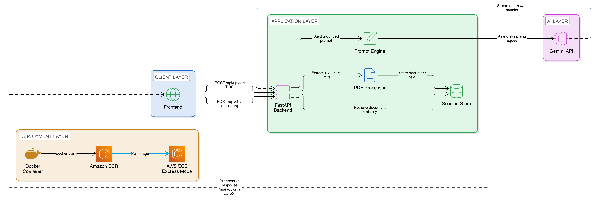

# DocuMind

**An AI-powered research paper assistant that answers questions grounded strictly in an uploaded document, not general knowledge.**

## Executive Summary

DocuMind lets a user upload a research paper (PDF) and ask natural-language questions about it, receiving answers generated from that document's content. Rather than using a conventional retrieval-augmented generation (RAG) pipeline with vector embeddings, DocuMind uses a deliberate **long-context injection** architecture: the full extracted document text is sent directly in the prompt on every request. This removes retrieval-quality risk and significantly reduces system complexity, while an explicit grounding strategy in the system prompt reduces the model's tendency to answer from outside knowledge or guess. Responses stream progressively and render both Markdown and LaTeX mathematical notation live, since academic papers mix both formats extensively.

## System Architecture



## Technical Trade-offs

**Long-context injection over RAG.** A standard RAG pipeline chunks a document, embeds each chunk, stores the embeddings in a vector database, and retrieves the top-k most relevant chunks per query. DocuMind instead sends the entire extracted document text on every request. This was a deliberate trade-off: a typical research paper (5,000-15,000 words) fits comfortably within a modern LLM's context window, so this approach removes the risk of a vector search missing a relevant chunk, and avoids the memory and deployment overhead of running an embedding model and vector database alongside the application. The documented cost is that it does not scale to very large documents or large multi-document collections.

**Prompt grounding strategy.** The system prompt enforces three behaviors that don't come from a model's default instincts: (1) answer only from the provided document text, never from general training knowledge; (2) state explicitly when a question isn't covered by the document rather than generating a plausible-sounding guess; (3) reference the relevant section of the document when possible, making answers traceable to their source. This reduces, but cannot fully eliminate, the possibility of unsupported answers.

**Dual Markdown/KaTeX rendering.** Model responses frequently mix Markdown formatting (headers, bold, lists) with LaTeX notation taken from the source paper (e.g. $d_{\text{model}} = 512$). Running a Markdown parser directly on raw LaTeX corrupts both, because LaTeX subscripts use underscores, which Markdown also interprets as italics. The frontend extracts math segments into placeholder tokens before Markdown runs, renders them separately with KaTeX, then splices the typeset equations back into the final HTML.

**Async streaming.** Responses are relayed through a native async generator using Gemini's async client, so text renders progressively in the browser instead of arriving as one block after a delay.

## API Endpoints

| Method | Endpoint | Description |
|---|---|---|
| POST | `/api/upload` | Accepts a PDF, extracts and validates text (page and token limits), returns a session ID |
| POST | `/api/chat` | Accepts `{session_id, question}` and streams a grounded answer from Gemini |

## Local Setup & Installation

**Prerequisites:** Python 3.11+ and a Google Gemini API key from [aistudio.google.com](https://aistudio.google.com).

```bash
git clone https://github.com/vidhya-dheep-kvsp/documind.git
cd documind/backend

pip install -r requirements.txt

cp .env.example .env        # Windows: copy .env.example .env
# Open .env and add your GEMINI_API_KEY

uvicorn app.main:app --reload --port 8000
```

Open `http://localhost:8000`, upload a PDF (max 25 pages / 10MB), and start asking questions.

## Running with Docker

From the project root:

```bash
docker build -t documind .
docker run -p 8080:8080 --env-file backend/.env documind
```

Then open `http://localhost:8080`.

## Deployment

DocuMind was containerized with Docker, the image was pushed to Amazon ECR, and it was deployed on AWS ECS Express Mode as a publicly accessible HTTPS application during my internship evaluation. The live instance has since been taken down to avoid ongoing cloud costs, so there is no live demo link. The Dockerfile in this repository reproduces the same container.

## Known Limitations

- Sessions are stored in memory and are lost on server restart
- Long-context injection does not scale to very large documents or document collections
- Free-tier Gemini quotas limit the number of requests per day

## Future Improvements

- Multi-document support with cross-paper question answering
- Persistent session storage (Redis or a database)
- Retrieval fallback for documents that exceed the context window
- User authentication for multi-user use

## Tech Stack

Python · FastAPI · pdfplumber · Google Gemini API (gemini-3.1-flash-lite) · marked.js · KaTeX · Vanilla JS · Docker